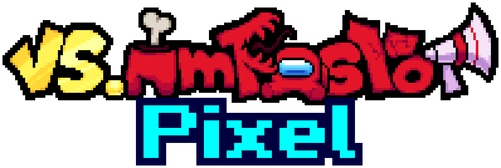

    <a href="https://github.com/kenton54/VS-IMPOSTOR-Pixel">
        <picture>
            <source media="(prefers-color-scheme: dark)" srcset=".artwork/github/logo-dark-scaledx10.gif">
            <source media="(prefers-color-scheme: light)" srcset=".artwork/github/logo-light-scaledx10.gif">
            
        </picture>
    </a>
    <h1>VS IMPOSTOR PIXEL</h1> <!-- this is just here so the table of contents thing shows stuff properly (???) -->
    
<b>Created by <a href="https://github.com/kenton54">kenton</a></b>

    
<b>VS IMPOSTOR PIXEL</b> is a <a href="https://ninja-muffin24.itch.io/funkin">Friday Night Funkin'</a> modification based of <a href="https://vsimpostor.com">VS IMPOSTOR Legacy</a> created by the team MotorFrog, which is based of the popular game <a href="https://www.innersloth.com/games/among-us">Among Us</a> made by <a href="https://www.innersloth.com">Innersloth LLC</a>.

    
The mod is fully compatible with Desktop and Mobile devices!

    

        Downloads
         
        <b>
        <a href="https://gamebanana.com/mods/506768">GameBanana</a>
        &middot;
        <a href="https://kenton54.itch.io/vs-impostor-pixel">Itch.io</a>
        &middot;
        <a href="https://gamejolt.com/games/vsimpostorpixel/1079175">GameJolt</a>
        &middot;
        <a href="https://drive.google.com/drive/folders/1D7bzf95Ig0HuAl6Zrm4iikSvv_Mc0cSm?usp=sharing">Google Drive</a>
        </b>
    

<h1 align="center">ABOUT</h1>

> [!WARNING]
> This part of the page is unfinished, there's a lot of missing information and images that need to be included throughout the showcase of the features, to provide better feedback or just make the page prettier.

> [!NOTE]
> Some of the features that are showcased down below aren't present inside the latest build of the mod yet, however some show when they're planned to be made public!

> [!NOTE]
> Some features mentioned down below are still ideas and could get scrapped in the future, whether it's because it sounds freaking impossible or just laziness lol.

**VS IMPOSTOR PIXEL** is a fanmade sequel and reimagination of VS IMPOSTOR Legacy, telling a revamped story, improvements of already-established characters, as well as a plethora of new ones!

Down below is all the features this mod contains:

## Story & Overworld

Featuring a complete reimagination of the story VS IMPOSTOR introduced to us, enhanced thanks to the Overworld!

Black Impostor has gone rogue and is tired by your little games, he wants to end you once and for all, but messes up his sabotaging in the process and ends up corrupting reality and resetting the timeline, undoing all of Boyfriend's progress!

What will be of our beloved short-sized blue-balled rapper? **Play the mod to find out!**

Play through all the Among Us maps, as well as fanmade-ones, solving puzzles and mysteries, discovering who the impostor is, foiling their plans, or sabotaging the crew! With a lot of fun and interesting interactions.

## Side Stories

Done with the main story? or are you just tired of the same rhythmic playstyle? Well look no further than the **Side Stories**!

Play a bunch of small games with new stories to tell, completely adjacent from the main experience, with non-rhythmic gameplay to spice up the overall experience!

**Coming Soon**

## Freeplay & Mini-Games

If you just want to get to the action right away, without going through a bunch of menus that just kill the mood, having to watch cutscenes that delay the fun (even though you can skip them), or just don't want to waste your time walking around the overworld, then the Freeplay menu is best suited for these situations!

Use it to quickly access all the content you've already played! But not only that... You can compete for the highscore! Get higher ranks! Achieve the fastest time! Be the best and most skilled crewmate (or impostor) in the world!!!

## Multiplayer

Ever wanted to play all the mod brings with a friend? Say no more!

**Coming in v3**

## Achievements

For all of those enthusiastic maniacs that want to 100% complete every single fucking game in their library!

Mind you some achievements are horrible to get... so get ready~!

**Coming Soon**

## Language & Localization

Ever wanted to enjoy a beloved project, but couldn't fully because the game doesn't support translations or doesn't have your native language? Not for this project!

Thanks to our amazing team of localizers, **YOU** can enjoy this project in **YOUR** language! No one gets left behind!!!

Current supported languages:

- English (United States)
- Spanish (Latin America)
- French (France)
- Russian
- German

**Coming in v1.5**

## Movie Theater & Jukebox

Do you want to re-watch those beautiful-looking cutscenes, or listen to the soundtrack the mod offers, without going through a bunch of different applications or websites? You can! all from the same place!

Rewatch your favorite moments with full control over the cutscenes! Skip ahead or rewind, speed up or slow down the playback, enjoy it your way!

Listen to your favorite songs or musics heard throughout the mod, dynamically change between other songs and remixes! And leave it playing in the background while you do your own thing.

<!-- And lastly for mobile users, it comes with fully integrated Bluetooth support! ok this one not yet it sounds beyond impossible -->

**Jukebox coming in v1.5**

**Movie Theater coming in v2**

## Others

TBA

<!--
<h1 align="center">STORY</h1>

	
<em>The story takes place right after VS IMPOSTOR.</em>

    
After Boyfriend finished his adventure, it's time for him to face off against Black Impostor one last time, freeing him from his parasitic nature or Boyfriend succumbing to his knife. After the sing-off, Boyfriend emerges victorious, however Black wasn't going to throw the towel just yet, decides to go all-in, no more games, just straight for the kill, but Boyfriend is too elusive for him, managing to dodge every single one of his attacks! Black, still not giving up, decides to do one last sabotage in yet another attempt to stop Boyfriend, however due to his sheer amount of anger, he messes up the sabotage and does something he doesn't fully understands for now, reality starts breaking apart, causing huge earthquakes and corruptions, not only breaking everything around them, but pixelating it as well. Black not wanting to lose his prey, once again continues to attack Boyfriend, starting a chase. After a barrage of attacks, corruptions and earthquakes, Boyfriend stops running after realizing he has nowhere else to run, in front of him, a huge bottomless-looking void filled with corrupt graphics, behind him, his demise, Black Impostor. He, now cornering him, mocks Boyfriend one last time for being his most interesting prey, for his unsuccessful attempts at stopping him and for making his slaughter more entertaining, finishing his speech telling him that it was fun foiling his plans, and that his head will be his most precious collection for his pile of corpses. Boyfriend, with nothing else to do anymore, gives up, but won't fall by Black's knife, he won't give him the satisfaction of killing him, so he decides to jump into the void, closing his eyes expecting the worse, slowly getting pixelated by the corruption, but alas escaping from Black's clutches once again...

    
The corruption consumes reality, making everything and everyone have a pixelated appearance. And the timeline gets reset, undoing Boyfriend's progress entirely...

-->

<h1 align="center">CREDITS</h1>

> [!NOTE]
> The mod's development workflow and its team are currently being completely refactored, so the list will appear with a lot less people than before. (or as you will see, mostly just me, kenton, lol)
>
> The change is only temporary, not permanent, and it will be reflected once the refactoring phase is over.

## Director

- kenton

## Artists, Pixel-Artists and Animators

- kenton

## Programmers

- kenton

## Musicians

_None_

## Charters

- kenton

## Writers

- kenton

## Translators & Localizers

<table>
    <tr>
        <th>Translator</th>
        <th>Language</th>
    </tr>
    <tr>
        <td>kenton</td>
        <td>Spanish (Latin America)</td>
    </tr>
    <tr>
        <td>Moxt</td>
        <td>French (France)</td>
    </tr>
    <tr>
        <td>Wøvenx</td>
        <td>Portuguese (Brazil)</td>
    </tr>
    <tr>
        <td>FuniFred</td>
        <td>Russian</td>
    </tr>
    <tr>
        <td>JustAlexus</td>
        <td>German</td>
    </tr>
</table>

## Special Thanks

- Silte – Composer of Sussus Moogus
- Volt Arix – Composer of Defeat <!-- github doesnt support this <a style="font-size:60%;color:gray;"><——— thanks to them this mod is where it is LOL tysm, seriously</a>-->
- Clowfoe – For creating VS IMPOSTOR, and for being a huge inspiration to me and many others \<3

---

	This is a project made for fun and with love, forever made free-to-play, never with the intent of profiting from it.
	 
    All rights and non-original assets present in the project belong to their respective owners.
	  
	<b>Friday Night Funkin'</b> owned by <b>The Funkin Crew Inc.</b>
	 
	<b>Among Us</b> <!--& <b>The Henry Stickmin Collection</b>--> owned by <b>Innersloth LLC</b>
	<!--  shhhh not yet
	<b>Sonic the Hedgehog</b> owned by <b>SEGA</b>-->

